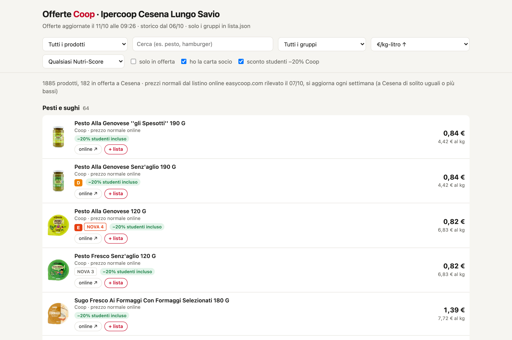
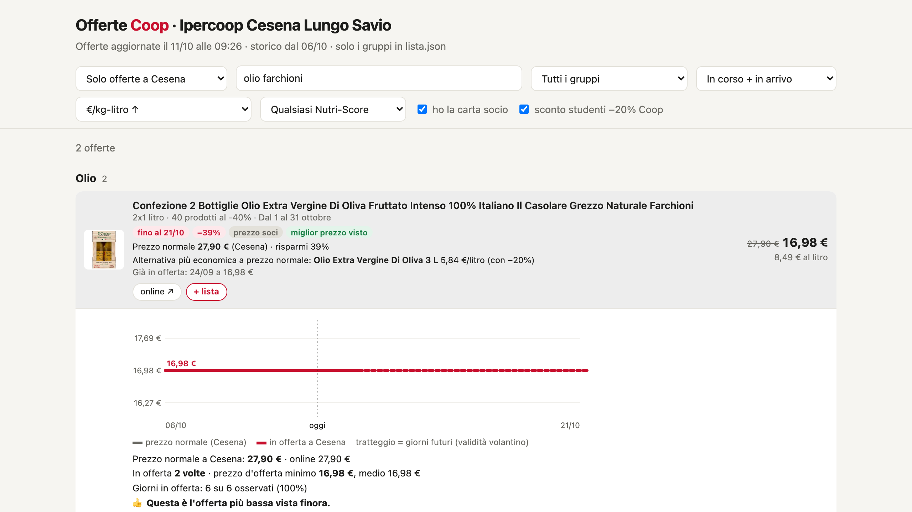
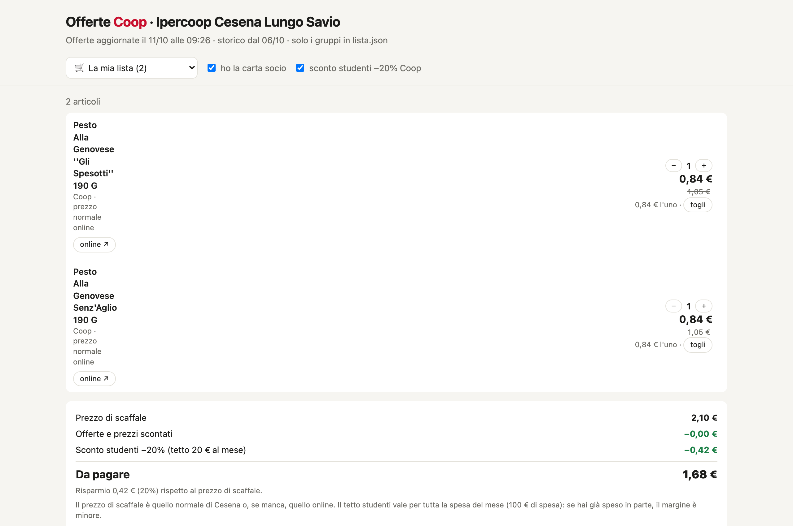
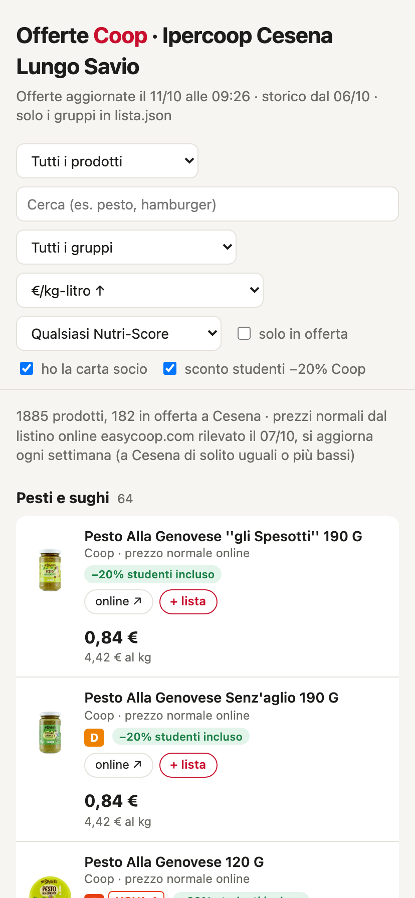

# coop-cesena

Offerte dei volantini dell'**Ipercoop Cesena Lungo Savio** (Coop Alleanza 3.0, negozio 0315) filtrate sui prodotti che compro, con storico prezzi, calcolo dello sconto soci e studenti, valori nutrizionali Open Food Facts e notifica macOS automatica.

🌐 **Demo live**: [luglistudio.github.io/coop-cesena](https://luglistudio.github.io/coop-cesena/)



## Funzionalità principali

- 🛒 **Tracciamento volantini live**: scarica le offerte attive dall'API ufficiale di Coop Alleanza 3.0 (negozio 0315 Cesena Lungo Savio).
- 🏷️ **Confronto con listino EasyCoop**: confronta ogni offerta con i prezzi normali di riferimento per capire se lo sconto è reale.
- 📉 **Storico prezzi e grafico interattivo**: registra l'andamento dei prezzi nel tempo in SQLite; un clic su ogni prodotto apre il grafico con prezzo minimo storico, media e frequenza di sconto.
- 🥗 **Qualità nutrizionale (Nutri-Score & NOVA)**: recupera automaticamente Nutri-Score (A–E) e classificazione NOVA (1–4) da Open Food Facts per ogni EAN.
- 🎓 **Calcolo sconti reali**: supporta carta socio e sconto studenti (−20% sui prodotti a marchio Coop con gestione del tetto mensile).
- 📋 **Lista della spesa integrata**: aggiungi i prodotti al carrello per calcolare il totale spesa, il risparmio complessivo e l'impatto degli sconti prima di andare in negozio.
- 🔔 **Notifiche native macOS**: LaunchAgent automatico ogni mattina alle 9:00 che notifica le nuove offerte uscite.

---

### Storico Prezzi & Grafico Andamento
Cliccando su un qualsiasi prodotto si apre l'andamento temporale del prezzo normale e dei periodi promozionali a Cesena, con indicazione del minimo storico e delle statistiche.



### Lista della Spesa & Calcolo Risparmio
Calcola in tempo reale il totale dello scontrino, il risparmio in euro e in percentuale rispetto allo scaffale, e applica il tetto mensile allo sconto studenti.



### Vista Mobile Responsive
Interfaccia ottimizzata per la consultazione da smartphone tra le corsie del supermercato.

<p align="center">
  
</p>

---

## Come usarlo

```bash
python3 coop.py          # offerte + index.html + notifica (~4 s); listino se ha più di 7 giorni
python3 coop.py listino  # forza anche il listino di confronto (qualche minuto)
python3 coop.py report   # rigenera solo index.html
open index.html
```

Solo libreria standard Python. Gira da solo ogni giorno alle 9:00 (LaunchAgent `com.coop-cesena`,
log in `aggiornamento.log`; se il Mac dorme, parte al risveglio).

## Cosa cerca: `lista.json`

Ogni gruppo ha `cerca` / `escludi` (regex sul testo dell'offerta: nome, formato, marca) e
facoltativamente `stagione: true` (calendario frutta/verdura per mese). Un'offerta finisce nel
primo gruppo che la accetta. `categorie_volantino` limita alle categorie considerate
(1 Dispensa, 2 Bevande, 3 Freschi, 4 Freschissimi, o categorie per la casa/igiene).

## Fonte dati

API pubblica usata dal sito coopalleanza3-0.it:
- `https://svdgt.coopalleanza3-0.it/apim/leaflets/0315` volantini attivi del negozio
- `https://svdgt.coopalleanza3-0.it/apim/{volantino}/0315/promos?` offerte con prezzi

Il volantino contiene solo le **offerte**: i prezzi normali di scaffale del negozio non sono
pubblici (si vedono solo nell'app Salvatempo, con login, scansionando in negozio).
Per confrontare, `coop.py` scarica anche il **listino easycoop.com** delle stesse categorie
(Coop Alleanza 3.0, stessi EAN; chiavi `easycoop` in `lista.json`). Sullo scontrino del
05/10/2026 i prezzi online erano uguali o fino al 23% più alti di Cesena: è un tetto, non il prezzo esatto.

Per ogni offerta la pagina mostra:
- prezzo normale (dal volantino se lo riporta, altrimenti stesso EAN online) e risparmio
- l'alternativa più economica al €/kg a prezzo normale, nella stessa sottocategoria
- "più conveniente del suo tipo" quando l'offerta batte tutto

Prezzi calcolati con carta socio e **sconto studenti −20% sui prodotti a marchio Coop**
(anche in offerta; max 100 € di spesa al mese, valido fino al 31/10/2026, poi va rinnovato).
Le due caselle in alto li tolgono. La scheda "Listino" mostra i prezzi normali di tutti i prodotti seguiti.

## Link e lista della spesa

Ogni prodotto ha un bottone **online ↗** (scheda easycoop) o **volantino ↗** (offerta Coop senza corrispondenza online).
Il bottone **+ lista** lo mette nella lista della spesa (voce "La mia lista" nel primo menu): quantità con − e +,
prezzo finale, risparmio rispetto allo scaffale e sconto studenti con tetto di 20 € al mese.
La lista si salva **nel browser di questo Mac** via `localStorage`.

## Confronto con la categoria

Cliccando un prodotto (offerta o no) si apre il grafico; sotto c'è **"Confronta con la categoria"**:
classifica per €/kg-litro di tutti i prodotti simili, in offerta o no, con il tuo evidenziato.
Dice in che posizione sei e quanti prodotti **senza offerta** costano meno. Due ambiti: "stesso tipo"
(sottocategoria easycoop, es. "Pasta di semola") o "tutto il gruppo" (es. Piadine). Si confrontano solo
prodotti con la stessa unità (kg con kg, litri con litri). Le sottocategorie arrivano dal listino easycoop.

## Quanto è salutare: Open Food Facts

Per ogni prodotto con codice a barre la pagina mostra **Nutri-Score** (A–E) e **NOVA**
(1 = non lavorato … 4 = ultra-trasformato), presi da Open Food Facts (database aperto).
Filtro "Nutri-Score A–B / A–C / poco lavorati" e ordinamento "più sano, poi €/kg".
Ogni EAN si richiede una volta sola e si riaggiorna ogni 90 giorni in locale.

## Dati: `offerte.db` (SQLite)

- `offerte`: una riga per offerta (volantino, validità, gruppo, prezzo, prezzo pieno, prezzo per tutti, €/kg, sconto, soci)
- `listino`: listino easycoop di riferimento (EAN, sottocategoria, prezzo normale, €/kg)
- `listino_prezzi`: una riga per ogni cambio di prezzo normale online
- `qualita`: Nutri-Score, NOVA, numero additivi, bio per EAN (Open Food Facts)
- `runs`: una riga per aggiornamento

Lo storico serve a capire ogni quanto un prodotto torna in offerta e a che prezzo.
I volantini scaduti spariscono dall'API Coop: lo storico si accumula in SQLite giorno per giorno.

## Disinstallare l'aggiornamento automatico

```bash
launchctl bootout gui/$(id -u)/com.coop-cesena && rm ~/Library/LaunchAgents/com.coop-cesena.plist
```
